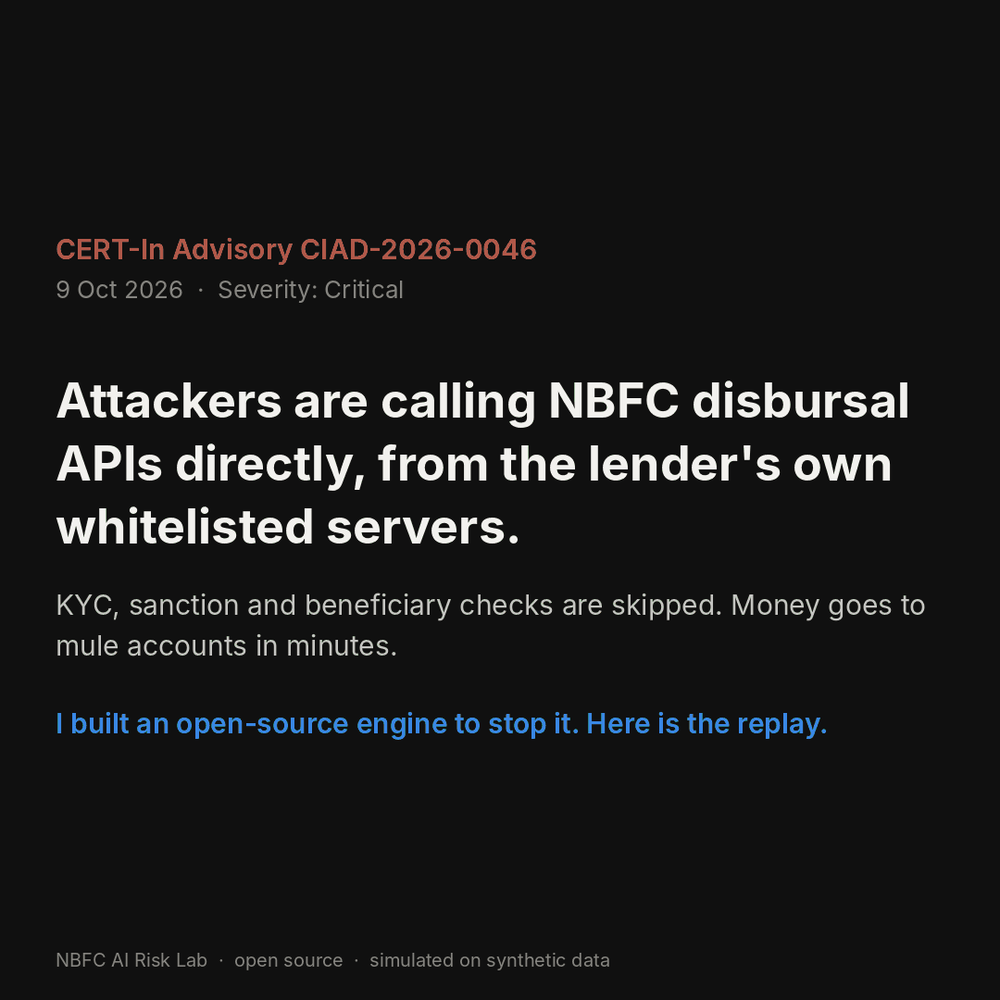

# NBFC AI Risk Lab

<p align="center">
  
</p>
<p align="center"><sub>27-second replay on synthetic traffic · <a href="media/attack_replay.mp4">MP4 version</a></sub></p>

A working, real-time engine that stops the disbursement-API fraud described in **CERT-In Advisory CIAD-2026-0046** (9 Oct 2026, severity Critical): fraudulent payouts made by calling an NBFC's disbursal APIs directly from its own whitelisted servers.

It combines deterministic hard controls with a behavioural AI layer, keeps a human in the loop, and proves log tampering. Everything runs on **synthetic data** with one command and produces an offline HTML dashboard.

> **Not a production system.** Results describe how the method behaves on simulated traffic. They are not performance claims for any real lender. A real deployment needs your own traffic, shadow-mode tuning and independent review.

---

## Quick start

You need Python 3.10 or newer.

```bash
pip install -r requirements.txt
python run_all.py
```

Then open `outputs/dashboard.html` in any browser. It works offline.

To run the checks:

```bash
python tests/test_lab.py          # or: python -m pytest -q
```

A full run takes about 20 seconds on a laptop.

---

## What the dashboard shows

| Tab | What you see |
| --- | --- |
| Disbursement API defence | Live attack timeline; amount attempted vs stopped; which layer stops what; each control mapped to the advisory; log-tampering evidence; auto-opened incident; alignment with the CERT-In Blueprint |
| Governance | How the engine answers "who decides, can we explain it, what if the AI is wrong, will it keep working, can we trust the logs" |

Every live-day API call, with its decision and the rules that fired, is written to `outputs/api_decisions_live.csv`.

---

## The problem: CIAD-2026-0046

The advisory describes attackers who:

* exploit internet-facing apps or deprecated, unauthenticated upload APIs;
* plant web shells and steal long-lived static API tokens;
* call disbursal APIs **directly from the entity's own whitelisted infrastructure**, skipping KYC, sanction and beneficiary checks;
* use dummy reference numbers, exceed limits, pay mule accounts across many banks;
* then delete or truncate logs.

The simulator replays that kill chain inside three days of normal traffic, including a subtle variant: real sanctioned loans whose beneficiary is swapped to a mule account.

## How the engine works

Every API call is checked in two layers as it arrives.

**Layer 1 – hard controls (block).** Each rule implements a recommended action from the advisory:

| Control | Advisory action it implements |
| --- | --- |
| Reference must exist in sanctioned records | Validate every payout against sanctioned records |
| Signed stage token required (KYC → sanction → beneficiary) | Bind multi-stage flows cryptographically |
| Per-transaction and per-day ceilings | Enforce ceilings at the API/payment stage |
| Beneficiary must match the penny-drop verified account | Beneficiary validation on all disbursement paths |
| Static long-lived tokens rejected | Per-session authentication; no static tokens |
| Unknown / deprecated APIs rejected | Complete API inventory; decommission unused APIs |
| Circuit breaker revokes a credential after repeated blocks | Disable compromised accounts; suspend affected APIs |

**Layer 2 – behavioural AI (hold for maker-checker).** A per-client Isolation Forest learns normal disbursal behaviour: velocity, how machine-regular the timing is, bank fan-out, amount and token age. Anomalies are **held for a human**, never auto-rejected.

**Tamper evidence.** Every decision is written to a hash-chained log, so deleted or edited lines are detectable.

## Results on the default run (synthetic)

* ₹37.68 Cr of fraudulent payouts attempted; ₹0 paid out
* Stolen credential revoked before the first fraudulent payout was attempted
* 8 of 975 genuine payouts held for human review; none blocked
* 25 deleted log lines detected by the hash chain

**The key finding:** the behavioural AI layer alone stops about 83% of fraudulent payouts. It misses the first payouts, before a velocity pattern exists, and slow beneficiary swaps that look normal. Cryptographic stage binding catches those. AI adds early warning; it does not replace hard controls.

---

## Repository layout

```
run_all.py                     one command: simulate, learn, replay, build dashboard
nbfc_lab/cyber/simulator.py    normal API traffic + CIAD-2026-0046 attack scenarios
nbfc_lab/cyber/engine.py       real-time engine: hard controls, behavioural AI, circuit breaker, hash-chained log
nbfc_lab/cyber/analysis.py     what was stopped, when, and at what false-positive cost
nbfc_lab/report.py             self-contained HTML dashboard
tools/make_linkedin_gif.py     square GIF/MP4 replay built from the run's outputs
media/                         replay GIF and MP4, outcome still, social preview image
docs/MODEL_CARD.md             model card for the behavioural anomaly model
docs/CONTROL_MAPPING.md        advisory and Blueprint mapping, and a path to production
tests/test_lab.py              9 checks (fraud stopped, no legit payout blocked, AI only holds, tamper detection ...)
```

---

## Adapting it to a real NBFC

* Feed the engine from your API gateway or WAF logs in place of the simulator.
* Issue stage tokens from your loan origination system, signed with a key held in an HSM or secrets manager.
* Wire the circuit breaker to your gateway's credential revocation, and HOLDs to your maker-checker queue.
* Run in shadow mode first and tune thresholds before enforcing.
* **Never** commit real customer data, keys or internal architecture details to a public repository.

---

## References

* CERT-In Advisory CIAD-2026-0046, *Threat Actors Exploiting Payment and Disbursement APIs for Unauthorized Fund Transfers in BFSI Entities*, 9 Oct 2026.
* CERT-In, *Blueprint for Reducing Exposure and Defending against AI-Assisted Vulnerabilities Exploitation in Digital Infrastructure*, Version 1.0, 25 May 2026.

Check for updated versions on the CERT-In website before relying on specific requirements.

---

## Licence

Apache License 2.0. See [LICENSE](LICENSE) and [NOTICE](NOTICE).
